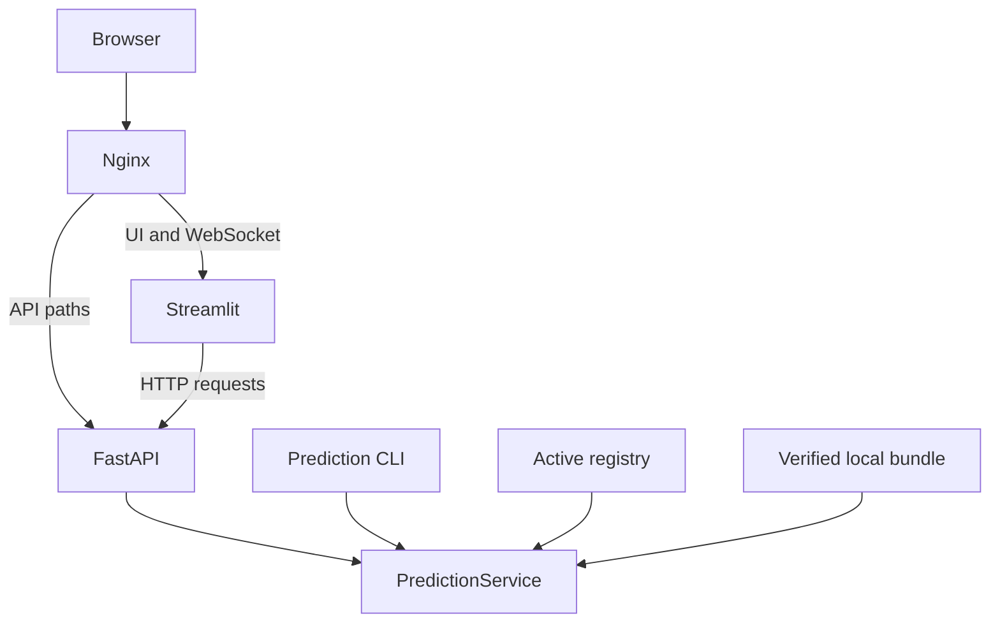

# Application Architecture

The application serves one selected neural checkpoint with two classification heads. FastAPI and the CLI use the same calibrated prediction service. Streamlit is an independent HTTP client and has no dependency on the backend Python package.

## Runtime boundaries

| Component | Runtime responsibility |
|---|---|
| `frontend/app.py` | Form requests, display API results and `422` errors |
| `app/main.py` | API lifecycle, readiness, prediction routes, and failure handling |
| `app/schemas.py`, `app/input_validation.py` | Strict request and response schemas and shared validation |
| `app/service.py` | Selected model loading, calibrated results, token information, and warnings |
| `app/prediction.py` | Local checkpoint reconstruction and prediction CLI |
| `app/registry.py`, `app/bundles.py` | Selection, pinned checksums, and bundle integrity |
| `app/tokenization.py` | Saved word vocabulary or transformer tokenizer and padding |
| Neural model modules | Shared representation plus style and tone output heads |

`app/ml.py` and joblib artifacts belong to the historical classical baseline. They are not imported by the current prediction routes. Neural inference applies the saved tokenizer to the supplied text without a spaCy lemmatization step.

## Model loading lifecycle

1. FastAPI's lifespan obtains the cached service once per process.
2. With no `TSD_CHECKPOINT` override, the service resolves the active entry in `TSD_REGISTRY`, defaulting to `artifacts/active_model.json` locally.
3. Registry pins and bundle checksums are verified, including the saved weights and dataset manifest file.
4. The loader checks model metadata, label order, output sizes, tokenizer compatibility, and calibration. It reconstructs the architecture, loads weights strictly, and switches to evaluation mode.
5. DistilBERT is reconstructed from the local encoder configuration and saved tokenizer. Inference does not call a remote pretrained-model download.
6. Readiness becomes successful. If loading fails, the exception is logged, liveness remains available, and readiness and prediction routes return `503`.
7. Shutdown releases the service and clears the process cache.

The trained bundle records training provenance and data fingerprints. Serving messages does not require the training dataset to be mounted; the separate evaluation command additionally checks compatibility against the actual prepared dataset.

Selection is persistent but loaded instances are pinned in memory. Select a different bundle on the host and restart the API to apply it. The public service requires a complete calibrated bundle, not a standalone legacy `best.pt`.

## Prediction flow

The API validates the complete request before tokenization and inference. It accepts a single message or a batch, preserves order and duplicate messages, and rejects invalid input with `422`.

The saved tokenizer encodes each message with the model's sequence-length limit. A lock protects shared tokenizer state and inference from concurrent calls. The model produces separate style and tone logits, and the service applies each task's saved temperature before softmax.

All adapters expose class scores, maximum-probability labels and confidence, character and token counts, unknown-token statistics, and structured warnings. Batch responses wrap the same prediction objects in `results`. The compatibility style/tone endpoints also return the complete object; Streamlit chooses which task to display.

Unfamiliar-input and uncertainty checks produce warnings without changing model outputs. The checks are documented in the [API reference](api.md).

## Containers and model storage

| Service | Files and dependencies | Network |
|---|---|---|
| Backend | `app/`, `api` dependency group, externally mounted model artifacts | Internal port 8000 |
| Frontend | `frontend/`, `.streamlit/`, `ui` dependency group | Internal port 8501 |
| Nginx | `nginx/nginx.conf` | Host port 8000 → container port 80 |

Both Python images use `python:3.13-slim-trixie` and install locked dependencies through uv. The frontend reads `API_URL` from the environment and does not import `app.*`, torch, transformers, or spaCy.

Compose bind-mounts host `./artifacts` at `/app/artifacts` with `read_only: true`. The mount contains both `active_model.json` and the selected full experiment directory. Keeping the directory layout under one artifacts root preserves relative registry paths when moving from Windows or another host into the Linux container.

The backend image neither copies trained weights nor requires `saving/`. `.dockerignore` excludes model artifacts from the build context. Its `HF_HUB_OFFLINE=1` environment setting prevents Hugging Face network access during serving.

The backend Dockerfile defines a standard-library HTTP healthcheck on `/health/ready`. Compose waits for this healthcheck before starting the frontend and Nginx. Missing model files therefore surface as an unhealthy backend and a startup dependency failure instead of an apparently ready deployment.

## Proxy routes

| Path | Destination |
|---|---|
| `/predict`, `/predict/batch`, `/predict/style`, `/predict/tone` | Backend prediction routes |
| `/health/live`, `/health/ready` | Backend health routes |
| `/model/info` | Backend model information |
| `/docs`, `/openapi.json` | Backend API documentation |
| Other paths | Streamlit, including WebSocket traffic |

Streamlit sends server-side requests directly to `http://backend:8000` in Compose. Browser and external API traffic use Nginx. Prediction proxy reads allow up to 120 seconds; clients still need to handle timeouts and `503` responses.

See [deployment](deployment.md) for commands and [shared prediction service](prediction-service.md) for the reusable Python interface.
