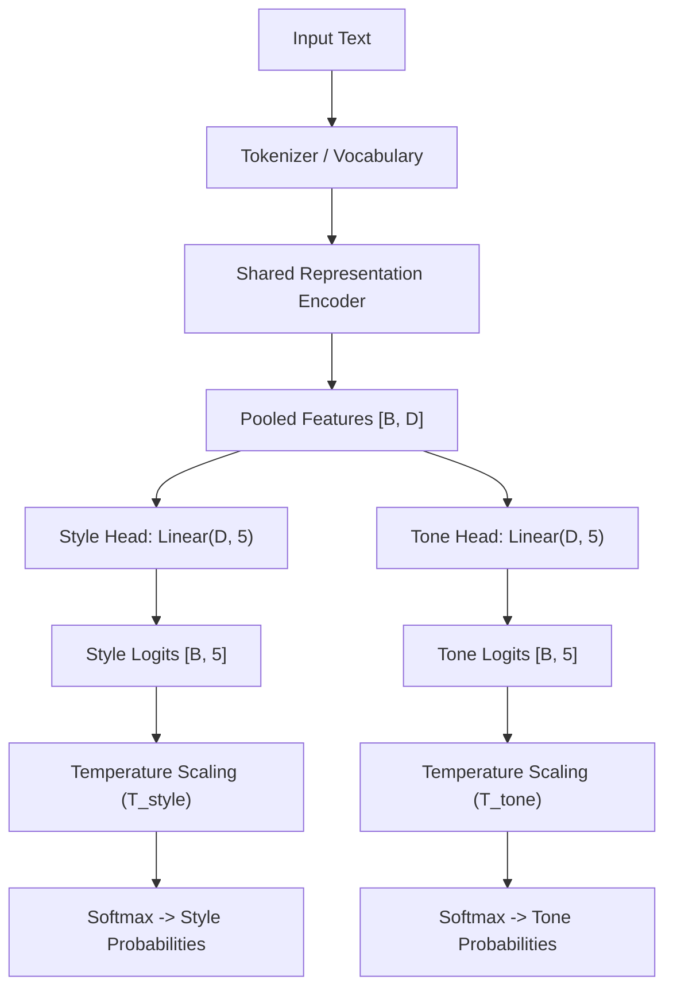

# Neural Model Architectures

The project implements three neural architectures for simultaneous multi-task classification of text style and emotional tone. Each model produces dual outputs from a shared sentence representation.

---

## 1. Multi-Task Learning Paradigm

All three architectures follow a hard parameter sharing design:

The total loss during training combines cross-entropy for both tasks:

$$\mathcal{L}_{\text{total}} = w_{\text{style}} \mathcal{L}_{\text{style}} + w_{\text{tone}} \mathcal{L}_{\text{tone}}$$

---

## 2. TextCNN Architecture (`app/models.py`)

TextCNN applies 1D convolutions over word embeddings to capture local n-gram patterns.

- **Vocabulary:** Custom learned vocabulary with casefolding, punctuation retention, and `<upper>` capitalization flags.
- **Embedding Layer:** Embedding dimension 128, with padding index 0.
- **Convolutional Banks:** Multiple parallel 1D convolution layers with kernel sizes 3, 4, and 5, each having 128 filters.
- **Padding-Safe Max Pooling:** Convolutions are masked to prevent padding tokens from leaking into max-pooled feature maps.
- **Dropout & Classification Heads:** Dropout rate 0.5 applied to concatenated pooled features (dimension $128 \times 3 = 384$). Dual linear projection layers output 5 logits for style and 5 for tone.

---

## 3. BiLSTM with Attention (`app/bilstm.py`)

BiLSTM processes sequential tokens in both directions, combining contextual hidden states with additive self-attention:

- **Sequence Packing:** Variable-length sequences are packed with `pack_padded_sequence` to ignore padding during recurrent steps.
- **Bidirectional LSTM:** 1 layer, hidden size 128 per direction (output dimension 256). Input-side forget gate biases initialized to 1.0.
- **Attention Mechanism:** Additive MLP attention computes normalized weights $\alpha_t$ over non-padded token states $h_t$:
  $$e_t = v^\top \tanh(W h_t), \quad \alpha_t = \frac{\exp(e_t)}{\sum_j \exp(e_j)}$$
  Context vector: $c = \sum_t \alpha_t h_t$.
- **Feature Concatenation:** Concatenates the attention context vector (256-d) with the final forward and backward hidden states (256-d), resulting in a 512-dimensional sentence embedding.
- **Classification Heads:** Linear layers map 512 features to 5 style classes and 5 tone classes.

---

## 4. DistilBERT Classifier (`app/distilbert.py`)

DistilBERT leverages a pre-trained transformer encoder (`distilbert-base-cased`):

- **Tokenizer:** Subword WordPiece tokenizer preserving case, adding `[CLS]` and `[SEP]` special tokens.
- **Transformer Encoder:** 6 layers, 12 attention heads, 768 hidden dimension. Fine-tuned with lower learning rate ($2 \times 10^{-5}$) for encoder and higher rate ($10^{-3}$) for heads.
- **Pooling:** Extracts the pooled representation corresponding to the first `[CLS]` token from the final hidden layer.
- **Pre-Classifier:** Linear layer ($768 \to 768$) with ReLU activation and 0.2 dropout.
- **Independent Task Heads:** Linear projections ($768 \to 5$) for style and tone.
- **Offline Inference:** Saved bundles include the encoder configuration and local tokenizer files. Inference runs with `HF_HUB_OFFLINE=1` without external downloads.

---

## 5. Post-Training Temperature Calibration

To convert uncalibrated logits into true posterior probabilities, post-hoc temperature scaling is applied independently to each task:

$$\hat{p}_{k} = \frac{\exp(z_k / T)}{\sum_j \exp(z_j / T)}$$

- Temperatures $T_{\text{style}} > 0$ and $T_{\text{tone}} > 0$ are optimized via bisection search on inverse temperature $1/T$ to minimize negative log-likelihood (NLL) on the **validation set only**.
- Temperature scaling preserves the logit rank order (argmax predictions are unchanged) while correcting overconfidence.
